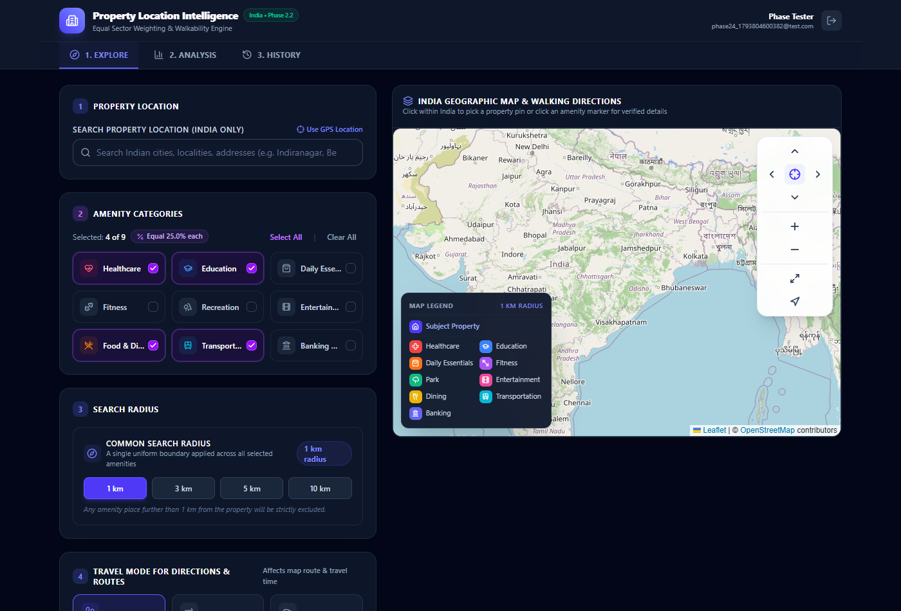
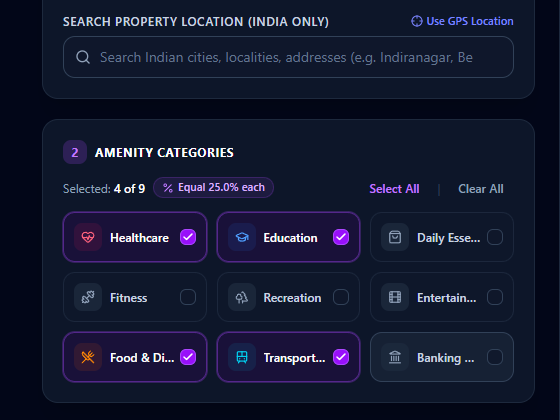
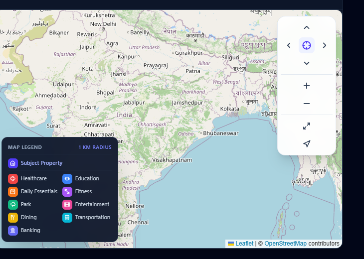
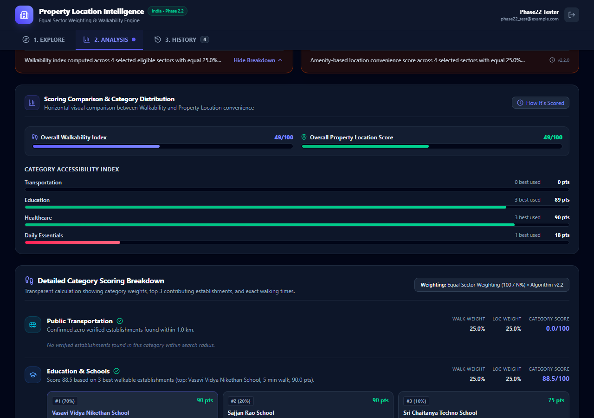
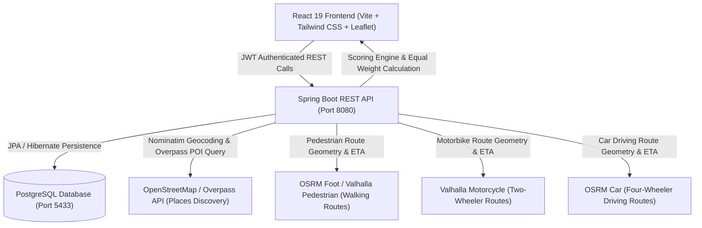

# Property Location Intelligence

[](frontend/)
[](backend/)
[](backend/)
[](LICENSE)

A modern full-stack web application for **Property Location Intelligence** and **Walkability Scoring**. Built to empower home buyers, real estate investors, and urban researchers to rigorously evaluate the physical surroundings, neighborhood accessibility, and real road-network connectivity of any property across India.

---

## Table of Contents

- [Overview](#overview)
- [Key Features](#key-features)
- [Screenshots](#screenshots)
- [Architecture & Data Flow](#architecture--data-flow)
- [Technology Stack](#technology-stack)
- [Walkability Scoring Algorithm](#walkability-scoring-algorithm)
- [Multi-Mode Travel Routing](#multi-mode-travel-routing)
- [Project Structure](#project-structure)
- [Prerequisites](#prerequisites)
- [Installation & Setup](#installation--setup)
  - [1. PostgreSQL Database Configuration](#1-postgresql-database-configuration)
  - [2. Backend Setup (Spring Boot)](#2-backend-setup-spring-boot)
  - [3. Frontend Setup (React + Vite)](#3-frontend-setup-react--vite)
- [Environment Variables](#environment-variables)
- [Running Locally](#running-locally)
- [Algorithm Limitations](#algorithm-limitations)
- [Future Improvements](#future-improvements)
- [License](#license)

---

## Overview

When evaluating a prospective home or property, traditional real-estate portals provide little more than basic straight-line radius estimates. **Property Location Intelligence** replaces synthetic approximations with real OpenStreetMap amenity data, verified road-network routing, and an explainable walkability scoring model based on equal sector weighting.

The platform is strictly bounded to Indian geographic territory, supports three distinct travel modes (**Walking**, **Scooter / Motorbike**, and **Car**), and provides an interactive three-tab interface (**Explore**, **Analysis**, and **History**).

---

## Key Features

- **Three-Tab Dashboard Interface**:
  - **1. Explore Tab**: Address/locality search, interactive Leaflet map, 9-category amenity selection, search radius selector, multi-mode travel picker, and place discovery drawer.
  - **2. Analysis Tab**: Dual scoring meters (Walkability Score and Property Location Score), comparative charts, equal sector breakdown ($100 / N\%$), and candidate route timelines.
  - **3. History Tab**: Persistent PostgreSQL analysis logs with timestamp, address, radius, and individual or bulk deletion.
- **Redesigned Amenity Category Selector**:
  - Compact 9-tile responsive grid (Healthcare, Education, Daily Essentials, Fitness, Recreation, Entertainment, Food & Dining, Transportation, Banking & Services).
  - Subtle purple highlight theme with clean checkmark indicators.
  - Dynamic equal weighting calculation ($100 / N\%$ per selected category).
  - Zero-selection guard: blocks analysis submissions and alerts users if no categories are chosen.
- **Floating Leaflet Map Navigation Toolbar**:
  - Ergonomic floating control surface located at the top-right of the map.
  - D-Pad Directional Pan Controls (**Up**, **Down**, **Left**, **Right**).
  - Center **Recenter** button returning viewport to selected property pin or national India view.
  - **Zoom In** and **Zoom Out** controls (default Leaflet duplicate zoom control removed).
  - **Fullscreen Toggle** with automatic tile resizing (`map.invalidateSize()`).
  - **Locate Me** GPS geolocation detector with India territorial boundary verification.
  - Event propagation isolation preventing toolbar clicks from triggering property pin placement.
- **Multi-Mode Road Network Routing**:
  - **Walking (`WALKING`)**: Strictly pedestrian routing through walkways, footpaths, and pedestrian plazas.
  - **Scooter / Motorbike (`MOTORBIKE`)**: Motorized two-wheeler routing via Valhalla motorcycle costing engine.
  - **Car (`CAR`)**: Automobile driving profile respecting dual-carriageway and arterial road rules.
- **Strict Walkability Isolation**:
  - Walkability scoring is **100% pedestrian-bound**. Switching travel modes in the UI updates visual map polylines and ETAs without skewing the pedestrian walkability score.
- **India Geographic Scope**:
  - Strict bounding box enforcement ($6.0^\circ\text{N} \le \text{lat} \le 37.5^\circ\text{N}$, $68.0^\circ\text{E} \le \text{lon} \le 98.0^\circ\text{E}$).
  - Automatically rejects search queries or coordinate picks outside India.

---

## Screenshots

| Full Dashboard View | Redesigned Amenity Selector |
| :---: | :---: |
|  |  |

| Floating Leaflet Map Controls | Analysis & Walkability Breakdown |
| :---: | :---: |
|  |  |

---

## Architecture & Data Flow



---

## Technology Stack

### Frontend
- **Framework**: React 19 (Hooks, Context API)
- **Language**: TypeScript 5.x
- **Build Tool**: Vite 8.x
- **Styling**: Tailwind CSS 4.x
- **Mapping**: Leaflet 1.9 & Leaflet MarkerCluster
- **Icons**: Lucide React
- **HTTP Client**: Axios with JWT interceptors
- **Routing**: React Router v7

### Backend
- **Framework**: Spring Boot 3.3.4
- **Language**: Java 21 (LTS)
- **Security**: Spring Security 6 with stateless JWT (`jjwt 0.12.6`) & BCrypt
- **Persistence**: Spring Data JPA / Hibernate
- **Geocoding & POI**: OpenStreetMap Nominatim & Overpass API
- **Routing Engine**: OSRM (Routed Foot & Car) + Valhalla (Motorcycle costing)
- **Build Tool**: Apache Maven 3.9+

### Database
- **Engine**: PostgreSQL 16+ (configured on port 5433 / configurable)
- **Tables**: `users`, `location_analyses`, `analysis_amenity_selections`

---

## Walkability Scoring Algorithm

The Walkability Score evaluates neighborhood convenience on a transparent **0 to 100** scale using verified pedestrian walking routes.

### 1. Equal Sector Importance Formula
Every user-selected amenity sector receives an equal weight:
$$W_i = \frac{100}{N}\%$$
*Where $N$ is the count of user-selected categories ($1 \le N \le 9$).*

- If 4 categories are selected: $W_i = 25.0\%$ each.
- If 9 categories are selected: $W_i = 11.1\%$ each.

### 2. Multi-Candidate Decayed Contribution
Within each category, the algorithm evaluates up to the top-3 closest candidates using diminishing weights to reward depth without allowing distant establishments to dominate:
$$S_{\text{category}} = 0.70 \times A_1 + 0.20 \times A_2 + 0.10 \times A_3$$
- If 2 places exist: normalized to $77.8\% \times A_1 + 22.2\% \times A_2$.
- If 1 place exists: $100\% \times A_1$.

### 3. Pedestrian Walking Time Decay Curve
Candidate accessibility score $A_k$ decays based on actual road-network pedestrian travel time:
- $T \le 300\text{ seconds}$ ($\le 5\text{ min}$): **100 pts**
- $300\text{s} < T \le 600\text{s}$ ($5\text{–}10\text{ min}$): **85 pts**
- $600\text{s} < T \le 900\text{s}$ ($10\text{–}15\text{ min}$): **65 pts**
- $900\text{s} < T \le 1200\text{s}$ ($15\text{–}20\text{ min}$): **40 pts**
- $1200\text{s} < T \le 1800\text{s}$ ($20\text{–}30\text{ min}$): **15 pts**
- $T > 1800\text{ seconds}$ ($> 30\text{ min}$): **0 pts**

### 4. Overall Location & Walkability Score
$$\text{Walkability Score} = \sum_{i=1}^N \left( \frac{100}{N} \times \frac{S_i}{100} \right) = \frac{1}{N} \sum_{i=1}^N S_i$$

---

## Multi-Mode Travel Routing

| Travel Mode | Engine / Endpoint | Profile Used | Polyline Styling | Description |
| :--- | :--- | :--- | :--- | :--- |
| **Walking** | `routing.openstreetmap.de/routed-foot` | `pedestrian` | Emerald green dashed line (`#10b981`) | Routes along sidewalks, pedestrian pathways, contraflow alleys, and parks. Speed $\approx 4.8\text{ km/h}$. |
| **Scooter / Bike** | `valhalla1.openstreetmap.de/route` | `motorcycle` | Purple solid line (`#a855f7`) | Motorized two-wheeler routing with polyline6 decoding, respecting Indian two-wheeler road access. |
| **Car** | `routing.openstreetmap.de/routed-car` | `driving` | Sky blue solid line (`#3b82f6`) | Automobile routing respecting medians, one-way avenues, and divided carriageways. |

---

## Project Structure

```
walkability-score/
├── backend/
│   ├── src/
│   │   ├── main/java/com/property/intelligence/
│   │   │   ├── controller/          # REST Endpoints (Auth, Analysis, Route, Location)
│   │   │   ├── dto/                 # Request & Response Data Transfer Objects
│   │   │   ├── entity/              # JPA Entities (User, LocationAnalysis, AmenitySelection)
│   │   │   ├── integration/
│   │   │   │   ├── geocoding/       # Nominatim & Photon Forward/Reverse Geocoding
│   │   │   │   ├── places/          # Overpass API Real POI Discovery
│   │   │   │   └── routing/         # OSRM & Valhalla Multi-Mode Routing Engines
│   │   │   ├── repository/          # Spring Data JPA Repositories
│   │   │   ├── scoring/             # Walkability & Equal Sector Scoring Engine
│   │   │   └── security/            # JWT Filter, Token Provider, Security Config
│   │   └── test/java/               # Unit and Integration Tests (50 test cases)
│   ├── pom.xml                      # Maven Build Configuration
│   └── .env.example                 # Backend Environment Template
├── frontend/
│   ├── src/
│   │   ├── components/              # UI Components (Map, Selector, Controls, Drawers)
│   │   ├── context/                 # AuthContext & State Management
│   │   ├── pages/                   # DashboardPage, LoginPage, SignupPage
│   │   ├── services/                # Axios API Client
│   │   └── types/                   # TypeScript Interfaces & Enums
│   ├── package.json                 # Frontend Dependencies
│   └── vite.config.ts               # Vite Configuration
├── docs/
│   └── screenshots/                 # Application Screenshots
├── .env.example                     # Root Environment Variable Template
├── .gitignore                       # Git Exclusion Rules
└── README.md                        # Project Documentation
```

---

## Prerequisites

Ensure you have the following installed on your machine:
- **Java Development Kit (JDK)**: Version 21 LTS
- **Node.js**: Version 18.x, 20.x, or 22.x
- **npm**: Version 9.x or later
- **PostgreSQL**: Version 15+ or 16+
- **Git**: Version 2.30+

---

## Installation & Setup

### 1. PostgreSQL Database Configuration

Create the PostgreSQL database and user:
```sql
CREATE DATABASE property_intelligence;
CREATE USER postgres WITH ENCRYPTED PASSWORD 'postgres';
GRANT ALL PRIVILEGES ON DATABASE property_intelligence TO postgres;
```

*(Note: If your local PostgreSQL server runs on the standard port `5432` instead of `5433`, update `DB_PORT=5432` in `backend/.env` or `application.properties`)*.

### 2. Backend Setup (Spring Boot)

1. Navigate to the backend directory:
   ```bash
   cd backend
   ```
2. Copy `.env.example` to `.env` (optional, default fallback values are provided):
   ```bash
   cp .env.example .env
   ```
3. Run Maven tests to verify all 50 tests pass:
   ```bash
   mvn test
   ```
4. Start the Spring Boot application:
   ```bash
   mvn spring-boot:run
   ```
   *The backend will start at `http://localhost:8080`.*

### 3. Frontend Setup (React + Vite)

1. Open a new terminal and navigate to the frontend directory:
   ```bash
   cd frontend
   ```
2. Install dependencies:
   ```bash
   npm install
   ```
3. Verify production compilation:
   ```bash
   npm run build
   ```
4. Start the Vite development server:
   ```bash
   npm run dev
   ```
   *The frontend will launch at `http://localhost:5173`.*

---

## Environment Variables

| Variable | Description | Default Value |
| :--- | :--- | :--- |
| `SERVER_PORT` | Spring Boot HTTP port | `8080` |
| `DB_HOST` | PostgreSQL hostname | `localhost` |
| `DB_PORT` | PostgreSQL port | `5433` *(or `5432`)* |
| `DB_NAME` | Database name | `property_intelligence` |
| `DB_USER` | Database username | `postgres` |
| `DB_PASSWORD` | Database password | `""` |
| `JWT_SECRET` | 256/512-bit hex secret key for JWT signing | *(Preconfigured default hex)* |
| `JWT_EXPIRATION_MS`| JWT validity duration in milliseconds | `86400000` (24 hours) |
| `VITE_API_BASE_URL` | Frontend REST API endpoint | `http://localhost:8080/api` |

---

## Running Locally

1. Ensure PostgreSQL is running on port 5433 or 5432 with database `property_intelligence`.
2. Start the backend:
   ```bash
   cd backend && mvn spring-boot:run
   ```
3. Start the frontend:
   ```bash
   cd frontend && npm run dev
   ```
4. Open your browser and navigate to:
   ```
   http://127.0.0.1:5173
   ```
5. Click **Sign Up** to create an account, log in, and explore any property in India!

---

## Algorithm Limitations

1. **OpenStreetMap Tagging Variation**: POI completeness depends on contributor coverage; dense urban metros (Bengaluru, Delhi, Mumbai) feature comprehensive tagging, while remote rural outskirts may under-report small local businesses.
2. **Pedestrian Routing Infrastructure**: Walkability routes depend on mapped walkways and footpaths; informal shortcuts or gated community access codes are not modeled.
3. **Environmental Factors**: The current engine evaluates spatial proximity and travel time; environmental factors such as slope/gradient, sidewalk width, shade, and nighttime street lighting are slated for Phase 3.

---

## Future Improvements

- **Public Transit Timetable Integration**: Integrate GTFS real-time transit data for Indian metro systems (Namma Metro, Delhi Metro, Mumbai Metro).
- **Microclimate & Green Cover Index**: Incorporate satellite vegetation indexes (NDVI) to score park canopy coverage.
- **Elevation & Slope Penalties**: Incorporate Digital Elevation Models (DEM) to adjust pedestrian walking speed for steep inclines.
- **Custom User Weighting Profiles**: Allow users to toggle between "Equal Weighting" and customized priority profiles (e.g., "Parent Profile" weighting schools higher; "Retiree Profile" weighting healthcare higher).

---

## License

This project is licensed under the **MIT License** — see the [LICENSE](LICENSE) file for details.
